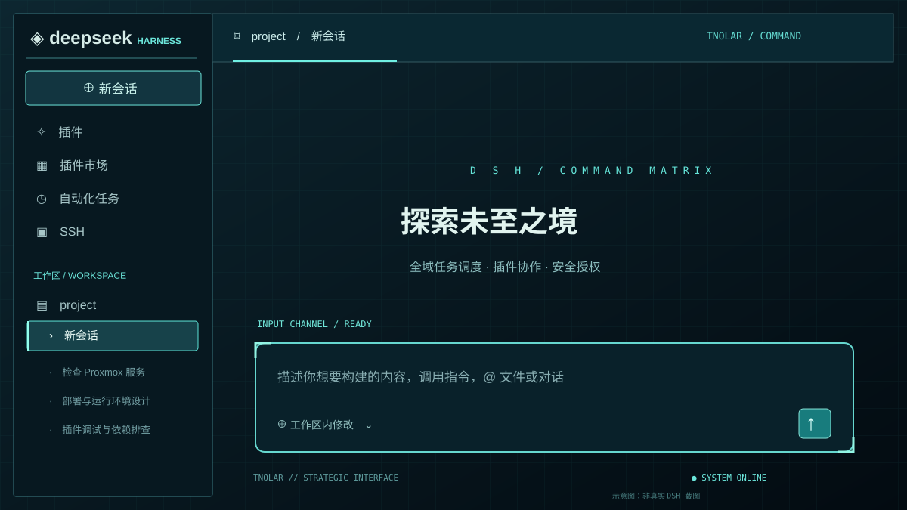
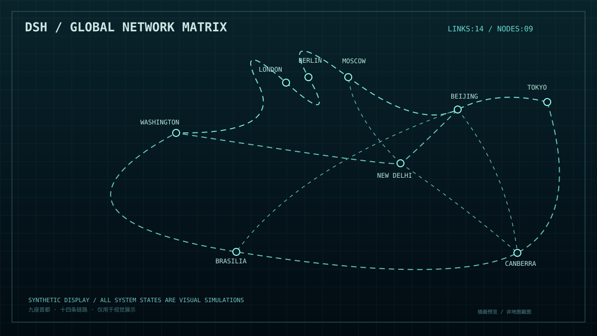

# DSH Theme TNOLAR｜战略指挥终端主题 + 世界地图启动动画

> 面向 **DeepSeek Harness（DSH）Web** 的非官方深色主题插件：以 TNO / LAR 式冷战控制台为视觉灵感，统一工作区、侧栏会话、顶部标题区与聊天输入区，并提供独立的全球首都网络开机动画与交互式授权解锁界面。
>
> **非官方作品**。不包含 TNO/LAR 游戏源码或专有贴图；地图线路、权限解锁和系统状态均为视觉演示，**不代表实际联网或真实授权**。



<details>
<summary>查看世界地图启动动画预览</summary>



</details>

## 主要功能

- **完整 DSH 主题化（v0.4.0 起）**：侧栏底板、插件导航、工作区分组、会话 hover / 选中态、顶部会话标题栏、面包屑、标签页、输入框、发送按钮、通用按钮、对焦描边、代码块与滚动条。视觉重点为军工设备面板、扫描网格、青绿信号光和低干扰高对比文本。
- **可靠的会话识别**：当前会话带青绿色左侧识别条、边框与弱光晕；其他会话保持暗色，避免亮色块喧宾夺主。
- **统一交互体系**：将 DSH `--dsw-*` 语义变量和圆角尺度统一到深色控制台风格；危险/错误状态保留红色，不会全部被染成绿色。
- **极简机械授权 UI**：钥匙动作由 3D 动画、机械光效与状态灯表达，界面不显示操作说明文字。
- **动画与主题结合**：开机自检 → 世界地图扫描 → 14 条指定路线建立 → 用户点击“授权解锁”或钥匙 → 金属钥匙向上插入、围绕自身长轴扭转解锁 → “请您指挥”待命卡片 → 用户点击进入控制台。
- **9 个首都，14 条路线**：已删除巴黎与其他多余连接，节点坐标按真实经纬度投影，曲线路径是动画示意。
- **可独立启停**：启动动画与主界面主题可分别开关，支持重播、跳过、交互授权、显式进入控制台；插件卸载时撤销样式和遮罩。
- **无需联网资源**：内置 HTML/SVG/CSS/JS；动画使用限制脚本权限的 sandbox iframe，不读取会话内容，不调用 SSH 或 Agent。
- **v0.5.3 细节修复**：输入区上传/附件图标跟随 TNOLAR 深色主题；授权钥匙改用细边视角，绕自身长轴执行 3D 扭转，而非在屏幕平面内转圈。
- **v0.5.2 拟物机械钥匙**：首次加入金属钥匙与锁芯动画，可点主按钮或任一钥匙启动四级解锁。
- **v0.5.0 交互与细节增强**：授权流程支持点击触发与密钥转动动画，待命文案更新，并继续保留 v0.4.1 对 classic-script 启动兼容性的修复。

> **兼容性说明**：已经完成打包检查、9 节点/14 链路测试和带模拟 DSH DOM 的浏览器烟雾测试；尚未在所有真实 DSH 安装与桌面环境上逐一验证。建议首次在独立 profile 中测试。v0.4.1 已通过 DSH classic-script 协议模拟测试，但仍需在真实 DSH 环境验证。GitHub README 的 SVG 预览为示意插画，非实际 DSH 运行截图；本地浏览器模拟测试另有 PNG 预览。

## 安装

### 从 GitHub 安装

确保 DSH CLI 已安装，且版本符合 `package.json` 内的 `engines.dsh` 范围（目前为 `>=0.2.0-0 <0.3.0-0`）。

```bash
dsh plugin --profile web add "github:AutomaticFlywings/dsh-theme-TNOLAR#main"
```

安装之后关闭并重启 DSH Web（使用你平时启动该 profile 的命令；例如 `dsh --profile web`）。在启动前可检查配置层是否加载：

```bash
dsh --profile web --dump-config
```

查找 `dsh-theme-tnolar`。如果你不是用 `web` 这个 profile，把安装命令中的 `web` 改成实际 profile。**GitHub 发布需要同时包含构建后的 `lib/client.js`**；本仓库已提交构建产物，无 `prepare` 安装脚本，不要求用户执行安装期构建。

更建议在重要部署中锁定经验证的具体提交：

```bash
dsh plugin --profile web add "github:AutomaticFlywings/dsh-theme-TNOLAR#<commit-sha>"
```

### 修复 v0.4.0 的 `Unexpected token 'export'` 启动失败

v0.4.0 曾把 `lib/client.js` 直接当 ESM 发布，而 DSH Web 实际通过经典 `<script>` 标签加载 Bundle，并要求客户端使用 `window.__ModuleLoader__.load({ id, factory })` 注册。浏览器因此会在启动页显示 `Failed to load plugins / import failed`。**v0.4.1 已修复构建格式。**

如果你正被错误启动页阻断，先在终端移除旧版并重新安装（不会删除会话内容）：

```bash
# 关闭正在运行的 DSH Web 服务后执行
dsh plugin --profile web remove dsh-theme-tnolar
dsh plugin --profile web add "github:AutomaticFlywings/dsh-theme-TNOLAR#main"
# 用你的正常启动命令重新启动 DSH，例如：
dsh --profile web
```

如果安装器保留了旧的 Git 缓存，建议改用本仓库 v0.4.1 的 `.tgz` 本地安装包或固定最新 commit 安装，再重启进程、强制刷新页面。Zotero / `inject.js` 中的 `Could not establish connection` 多数来自浏览器扩展，不代表 TNOLAR 加载失败。

### 本地安装和卸载

```bash
# 在下载了相应 tgz 的目录中执行
dsh plugin --profile web add "./dsh-theme-tnolar-0.5.3.tgz"

# 卸载后重启 DSH Web
dsh plugin --profile web remove dsh-theme-tnolar
```

如果同时装有其他全站主题，建议先禁用其中一个，以免 CSS token 互相覆盖。

## 视觉设计系统

| UI 区域 | TNOLAR 设计 | 对应的 DSH 组件 |
|---|---|---|
| 主工作区 | 深海军蓝、轻型 42px 网格、顶部渐变 | `AppFrame` / `ConversationRoot` |
| 左侧导航 | 军工面板底色、细导光边、激活项识别条 | `SidebarRoot` |
| 会话列表 | 低亮度默认态；选中态边框 + 左侧青色光条 | `Rows` / `WorkspaceBrowser` |
| 顶部标题栏 | 指挥台式分区、线形高亮、统一标签页 | `ConversationRoot` |
| 聊天输入区 | 13px 角半径、四角定位标记、青色焦点外发光 | `InputBar` |
| 按钮和状态 | 5–8px 小圆角、发光 hover、清晰键盘焦点 | DSH 控件与语义状态 token |
| 代码显示 | 等宽字体、低对比背景、细边界 | 通用代码块 |

核心色板：背景 `#06131B`、侧栏 `#071820`、面板 `#0B2029`、青绿信号 `#6BE5DA`、文字 `#E2F1ED`、警告 `#DFB873`、错误 `#EE8187`。这些色值都可以在 [src/tnolar-theme.css](src/tnolar-theme.css) 修改。

主题作用域由 `html[data-tnolar-theme="1"]` 限制；只有启用主题时才注入。优先修改 DSH 的语义颜色、圆角和交互变量，并对已在 DSH 上游源码中确认的几个 UI 组件使用针对性 CSS 规则，不使用会误伤 Markdown 与第三方插件的通配式元素覆盖。DSH 更新 CSS Modules 类名后，个别增强样式可能需要跟进；语义 token 仍可继续工作。

## 世界地图线路

节点为：**华盛顿、伦敦、柏林、莫斯科、新德里、北京、东京、巴西利亚、堪培拉**。巴黎已经删除。

| 组别 | 网络链路 | 连接数 |
|---|---|---:|
| 欧亚—北美主干 | 东京 → 北京 → 莫斯科 → 柏林 → 伦敦 → 华盛顿 | 5 |
| 南亚支线 | 北京 → 新德里 → 华盛顿 | 2 |
| 南半球主干 | 东京 → 堪培拉 → 巴西利亚 → 华盛顿 | 3 |
| 跨洲补充线 | 北京 → 巴西利亚；北京 → 堪培拉；新德里 → 莫斯科；新德里 → 堪培拉 | 4 |
| **合计** | **9 个首都、14 条线段** | **14** |

14 条线的起终点顺序保留在 `assets/world-startup.html` 的 `ROUTE_CODES` 中，由 SVG 自动绘制。

## 用户控制（浏览器控制台）

按 `F12` 打开 DSH Web 的 Console，可执行：

```js
window.DSHTNOLAR.replay();                 // 重新播放一次开场动画
window.DSHTNOLAR.skip();                   // 跳过当前动画
window.DSHTNOLAR.setEnabled(false);       // 关闭下次自动播放，保留主题
window.DSHTNOLAR.setEnabled(true);        // 恢复下次自动播放
window.DSHTNOLAR.setThemeEnabled(false);  // 立即关闭 TNOLAR 主题
window.DSHTNOLAR.setThemeEnabled(true);   // 立即开启 TNOLAR 主题
```

主题及动画开关分别存放于浏览器 `localStorage`；本版本没有 DSH 设置页图形开关。浏览器“减少动态效果”设置可影响开场动画。交互式动画会等待点击，不会在“系统已就绪”时自动退出；若动画加载失败或长时间无人操作，插件保留 120 秒看门狗保护，随时可以按 `Esc` 或点击“跳过动画”离开。

## 项目结构

```text
dsh-theme-TNOLAR/
├── package.json                     # npm 与 DSH bundle 声明
├── cordis.patch.yml                 # profile 插件层
├── lib/
│   ├── index.js                     # Host 入口（不请求特权）
│   └── client.js                    # 已预构建、可供 GitHub 安装的浏览器端
├── src/
│   ├── client.template.js           # 启动遮罩、生命周期、主题开关
│   └── tnolar-theme.css             # 完整 TNOLAR 主题 CSS
├── assets/world-startup.html       # 世界地图启动动画源文件
├── test/
│   ├── route-graph.test.mjs         # 路线回归测试
│   └── fixture-dsh-mock.html       # 模拟宿主（仅作视觉回归测试）
├── scripts/
│   ├── build.mjs                    # 打包 HTML 与主题 CSS 到 lib/client.js
│   ├── check.mjs                    # 校验构建文件与 DSH 清单
│   ├── verify-browser.py           # 浏览器端模拟宿主测试（可选）
│   └── verify-interaction.py       # 手动授权/密钥转动/进入控制台流程测试（可选）
├── docs/
│   ├── preview-tnolar-theme.svg    # 主题预览：GitHub 插画示意
│   ├── preview-tnolar-map.svg      # 启动地图预览：GitHub 插画示意
│   ├── DESIGN-SYSTEM.zh-CN.md      # 组件映射与设计规范
│   └── PUBLISHING.zh-CN.md         # 仓库维护说明
├── LICENSE
├── THIRD_PARTY_NOTICES.md
└── licenses/GSHHG-LGPL-3.txt
```

DSH Bundle 的核心配置：

```json
{
  "dsh": {
    "bundle": { "patch": "./cordis.patch.yml" },
    "client": { "platform": "web" }
  }
}
```

`cordis.patch.yml`：

```yaml
- insert:
    - id: dsh-theme-tnolar
      name: dsh-theme-tnolar
```

## 开发和验证

需要 Node.js（见 `engines.node`）；无额外运行时 npm 依赖。

```bash
npm run build
npm run check     # 包含 DSH classic-script 语法与模块注册协议检查
npm test
npm pack --dry-run
```

如果本机另有 Python、Playwright 和 Chromium，可继续执行浏览器模拟测试：

```bash
python scripts/verify-browser.py
python scripts/verify-interaction.py
```

每次修改 `src/client.template.js`、`src/tnolar-theme.css` 或 `assets/world-startup.html` 后，请先执行 `npm run build`，并将更新后的 `lib/client.js` 一起提交。`lib/index.js` 是 Host 侧 ESM，`lib/client.js` 则必须是 classic-script；两者的打包方式不能混用。仓库里的 CI 在 push 和 PR 时验证构建、静态规则与安装包组成，但 **不能代替在真实 DSH 环境安装测试**。

## 常见问题

**安装后没有变化？** 核实运行 profile 与安装 profile 一致，用 `dsh --profile web --dump-config` 查找插件层，然后完整重启 DSH Web。

**背景没有完全统一？** 如果同时使用了其他强制换肤插件，可能存在 token 冲突；先禁用它们再检查。若 DSH 升级造成组件类名变化，请附 DSH 版本与脱敏截图提交 Issue。

**会不会影响会话或 SSH？** 插件仅绘制启动动画与注入 CSS，没有调用会话读取、Agent、SSH 或上传接口。动画沙箱限制脚本权限，不具备同源数据访问。

**怎么回退？** 可先执行 `window.DSHTNOLAR.setThemeEnabled(false)` 并关闭自动播放，再卸载插件并重启 DSH Web。卸载会撤销由本插件创建的 DOM、样式和事件监听。

## 许可证和声明

原创代码采用 **MIT License**；地图矢量边界衍生于 GSHHG 数据，相关第三方许可证见 [THIRD_PARTY_NOTICES.md](THIRD_PARTY_NOTICES.md) 和 [licenses/GSHHG-LGPL-3.txt](licenses/GSHHG-LGPL-3.txt)。此项目与 DSH 官方、TNO / LAR 开发组无隶属或授权关系。禁止将画面中的模拟网络、模拟授权状态误称为真实联网能力。

源码参考：[DSH 官方插件打包文档](https://github.com/deepseek-ai/deepseek-harness/blob/master/docs/user/develop/basic/publish.zh.md) · [插件配置](https://github.com/deepseek-ai/deepseek-harness/blob/master/docs/user/develop/basic/config.zh.md) · [主题插件参考](https://github.com/nevertoday/dsh-theme-plugin)

**问题反馈**：请在 [GitHub Issues](https://github.com/AutomaticFlywings/dsh-theme-TNOLAR/issues) 提供 DSH 版本、系统、浏览器与脱敏错误日志。不要上传令牌、SSH 密钥、聊天内容或账号截图。